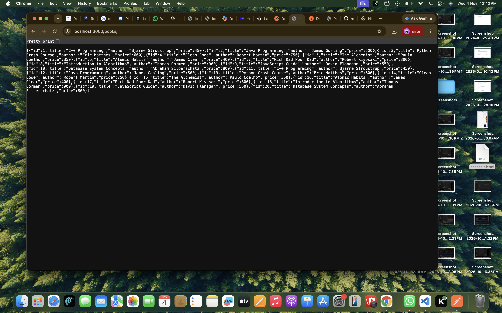
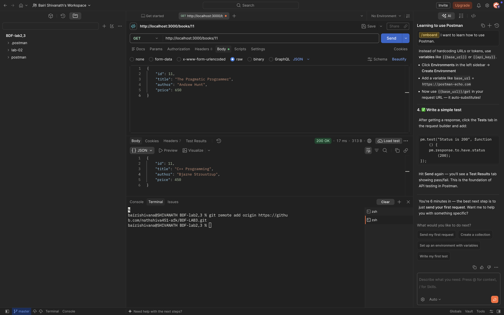
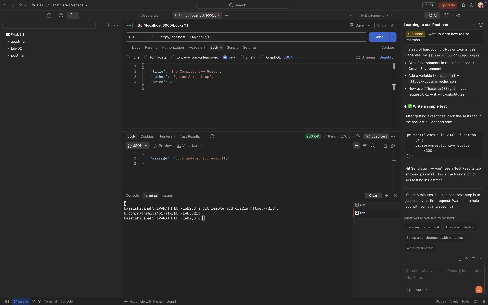
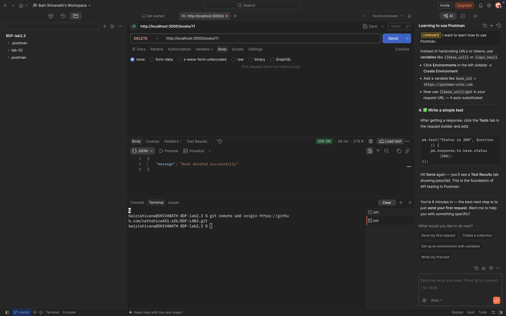

# Lab 2: SQLite Database and CRUD Routes

## Overview

This project implements a RESTful API using **Node.js, Express.js, and SQLite3**. It demonstrates basic database operations (CRUD) by managing a collection of books.

The API allows users to create, retrieve, update, and delete book records stored in an SQLite database.

## Technologies Used

- Node.js
- Express.js
- SQLite3
- JavaScript
- Postman
- Nodemon
- Git and GitHub
- Render (Deployment)

## Project Structure

```text
BDF-LAB3/
│
├── lab-02/
│   ├── database/
│   │   └── db.js
│   │
│   ├── routes/
│   │   └── books.js
│   │
│   ├── screenshot/
│   │   ├── getall.png
│   │   ├── getone.png
│   │   ├── post.png
│   │   ├── put.png
│   │   └── delete.png
│   │
│   ├── server.js
│   ├── package.json
│   ├── package-lock.json
│   ├── .gitignore
│   └── README.md
│
└── lab-03/
```

## Features

### 1. Database Connection

- Connects to an SQLite database.
- Creates the books table automatically.
- Inserts 10 sample books when the database is empty.

### 2. CRUD Operations

- Create new book records.
- Retrieve all books.
- Retrieve a specific book using its ID.
- Update existing book details.
- Delete book records.

### 3. JSON Request and Response Handling

- Accepts JSON data from API requests.
- Returns book records in JSON format.
- Provides appropriate response messages.

### 4. Error Handling

- Validates book IDs.
- Handles requests for books that do not exist.
- Returns appropriate HTTP status codes and error messages.

## API Endpoints

**Local Base URL:**

`http://localhost:3000`

**Live Base URL:**

`https://bdf-lab2-zloa.onrender.com`

**GIT HUB URL**  
https://github.com/nathshiva451-afk/BDF-LAB3/tree/main/lab-02


| Method | Endpoint | Description |
|---|---|---|
| GET | `/books` | Retrieve all books |
| GET | `/books/:id` | Retrieve a book by ID |
| POST | `/books` | Add a new book |
| PUT | `/books/:id` | Update a book |
| DELETE | `/books/:id` | Delete a book |

## Installation and Setup

### 1. Clone the Repository

```bash
git clone https://github.com/nathshiva451-afk/BDF-LAB3.git
```

### 2. Navigate to the Lab 2 Folder

```bash
cd BDF-LAB3/lab-02
```

### 3. Install Dependencies

```bash
npm install
```

### 4. Start the Development Server

```bash
npm run dev
```

The local server will start at:

`http://localhost:3000`

## Available Scripts

Start the application:

```bash
npm start
```

Start the application in development mode using Nodemon:

```bash
npm run dev
```

## Testing

The REST API was tested using Postman. The following screenshots demonstrate the CRUD operations and API responses.

### 1. Retrieve All Books



### 2. Retrieve a Book by ID



### 3. Add a New Book


### 4. Update an Existing Book



### 5. Delete a Book



All five screenshots are stored in the `screenshot/` directory and document the API testing process.

## GitHub Repository

**Lab 2 Source Code:**

[View Lab 2 on GitHub](https://github.com/nathshiva451-afk/BDF-LAB3/tree/main/lab-02)


## Live Deployment

**Deployment Platform:** Render

**Live API URL:**

[https://bdf-lab2-zloa.onrender.com/](https://bdf-lab2-zloa.onrender.com/)

### Test Live API

- [API Welcome Page](https://bdf-lab2-zloa.onrender.com/)
- [Retrieve All Books](https://bdf-lab2-zloa.onrender.com/books)

## Learning Outcomes

- Understanding REST API fundamentals.
- Connecting Node.js applications with SQLite.
- Creating and managing database tables.
- Performing CRUD operations.
- Using Express.js routes.
- Testing APIs using Postman.
- Handling HTTP status codes and errors.
- Managing project files using Git and GitHub.
- Deploying backend applications using Render.

---

**Subject:** Backend Development Fundamentals

**Lab:** 2 – SQLite Database and CRUD Routes