# Lab 3: SQLite Database and Advanced CRUD Operations

## Overview

This project implements a RESTful API using Node.js, Express.js, and SQLite3. It extends basic CRUD operations by introducing advanced database features such as searching, sorting, pagination, price filtering, input validation, and error handling.

The application manages book records stored in an SQLite database and provides API endpoints to perform different operations.

## Technologies Used

- Node.js
- Express.js
- SQLite3
- JavaScript
- Postman
- Nodemon
- Git and GitHub

## Project Structure

```text
lab-03/
│
├── database/
│   └── db.js
│
├── routes/
│   └── books.js
│
├── screenshots/
│   ├── 1-getall.png
│   ├── 2-searchbooks.png
│   ├── 3-sortasc.png
│   ├── 4-sortdesc.png
│   ├── 5-paginationfirst.png
│   ├── 6-paginationlast.png
│   ├── 7-pricefilter.png
│   ├── 8-combined_parameters.png
│   ├── 9-post.png
│   ├── 10-postmissing.png
│   ├── 11-post_missing_author.png
│   ├── 12-post_invalid_price.png
│   ├── 13-put_update.png
│   ├── 14-delete.png
│   ├── 15-not_found.png
│   └── 16-invalid_query.png
│
├── server.js
├── package.json
├── package-lock.json
├── .gitignore
└── README.md
```

## Features

### 1. Database Connection

- Connects to an SQLite database.
- Creates the books table automatically.
- Inserts 10 sample books when the table is empty.

### 2. CRUD Operations

- Create new book records.
- Retrieve all books.
- Retrieve a specific book using its ID.
- Update existing book details.
- Delete book records.

### 3. Search Functionality

Search books using the `search_q` query parameter.

Example:

```http
GET /books?search_q=Java
```

### 4. Sorting

Sort books using a selected column and sorting order.

Example:

```http
GET /books?order_by=price&order=ASC
```

Supported sorting columns:

- id
- title
- author
- price

Sorting options:

- ASC – Ascending order
- DESC – Descending order

### 5. Pagination

Retrieve books in smaller groups using `limit` and `offset`.

Example:

```http
GET /books?limit=5&offset=0
```

```http
GET /books?limit=5&offset=5
```

### 6. Price Filtering

Filter books based on minimum and maximum prices.

Example:

```http
GET /books?min_price=300&max_price=600
```

Individual filters are also supported:

```http
GET /books?min_price=300
```

```http
GET /books?max_price=600
```

### 7. Combined Query Parameters

Multiple query parameters can be used in a single request.

Example:

```http
GET /books?search_q=Java&order_by=price&order=ASC&limit=5&offset=0&min_price=300&max_price=600
```

### 8. Input Validation and Error Handling

- Validates book titles and authors.
- Checks that prices are numeric and non-negative.
- Validates book IDs.
- Checks sorting columns and sorting order.
- Validates pagination values.
- Checks minimum and maximum price ranges.
- Returns appropriate HTTP status codes and JSON error messages.

## API Endpoints

Base URL:

`http://localhost:3001`

| HTTP Method | Endpoint | Description |
|---|---|---|
| GET | `/` | Display API welcome page |
| GET | `/books` | Retrieve books with search and filters |
| GET | `/books/:id` | Retrieve a book by ID |
| POST | `/books` | Add a new book |
| PUT | `/books/:id` | Update a book |
| DELETE | `/books/:id` | Delete a book |

## Installation and Setup

### 1. Clone the Repository

```bash
git clone https://github.com/nathshiva451-afk/BDF-LAB3.git
```

### 2. Navigate to the Lab 3 Folder

```bash
cd BDF-LAB3/lab-03
```

### 3. Install Dependencies

```bash
npm install
```

### 4. Start the Development Server

```bash
npm run dev
```

The server will start at:

`http://localhost:3001`

## Available Scripts

Start the application:

```bash
npm start
```

Start the application in development mode using Nodemon:

```bash
npm run dev
```

## Testing

The REST API was tested using Postman. The following screenshots demonstrate the successful API operations and validation tests.

### 1. Retrieve All Books

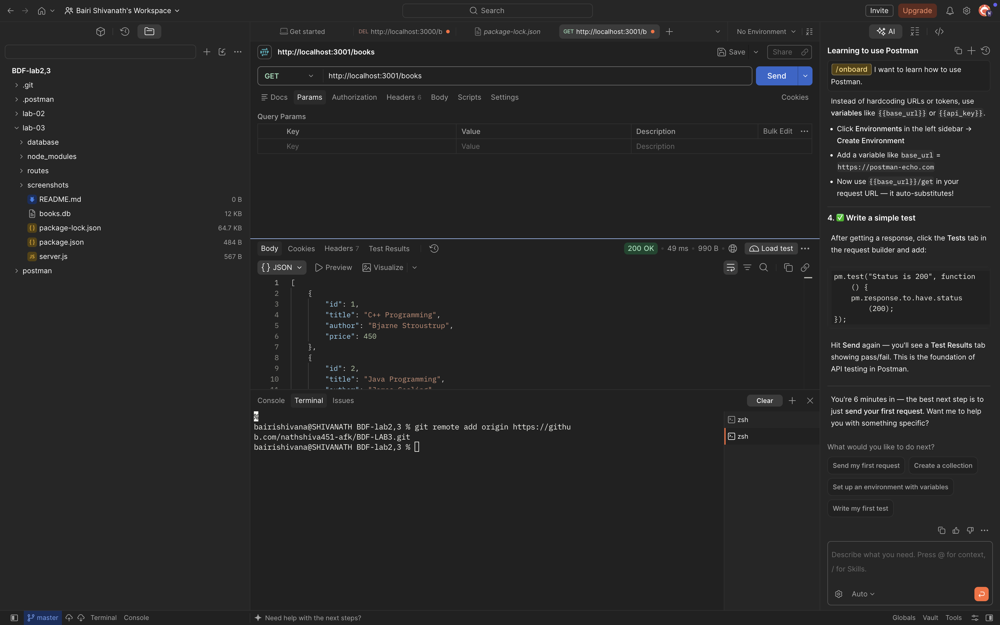

### 2. Search Books

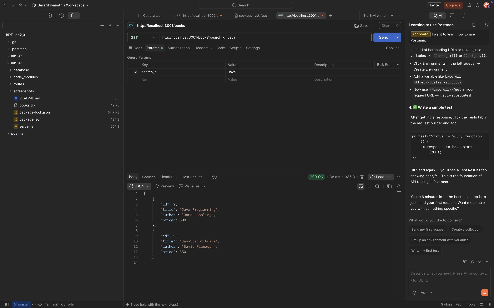

### 3. Sort Books in Ascending Order

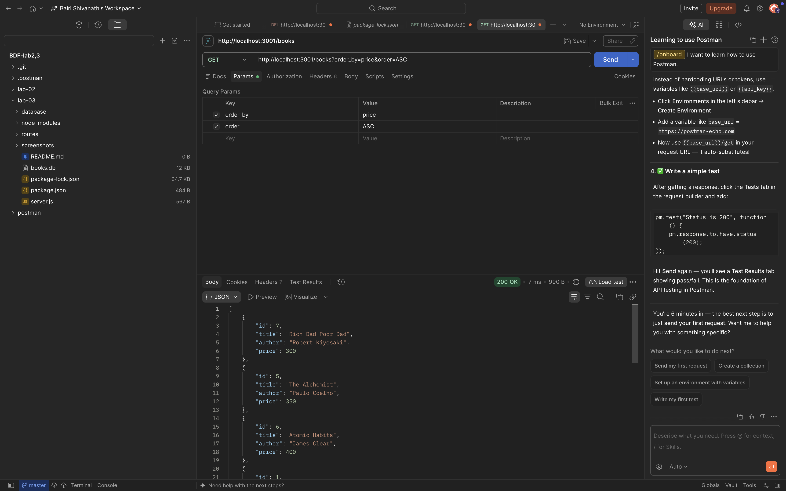

### 4. Sort Books in Descending Order

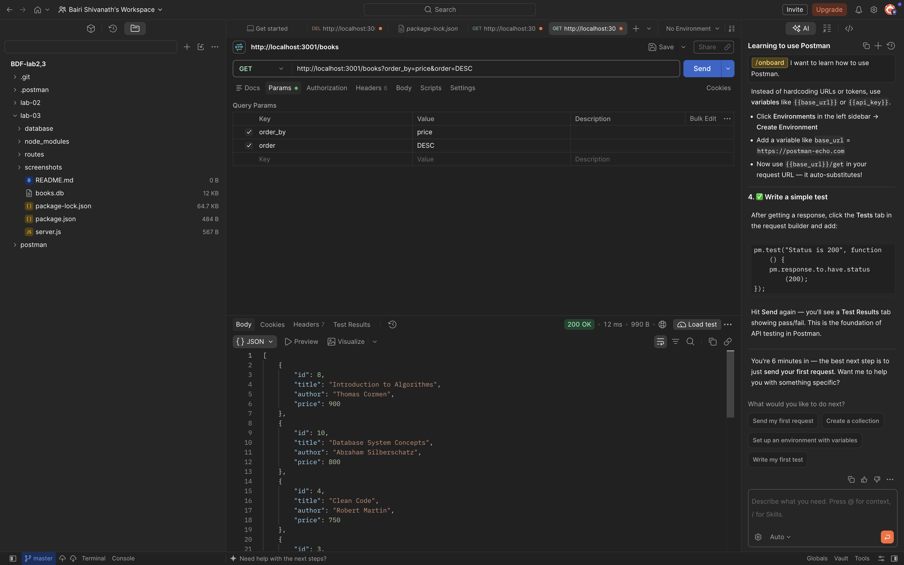

### 5. First Page Pagination


### 6. Next Page Pagination

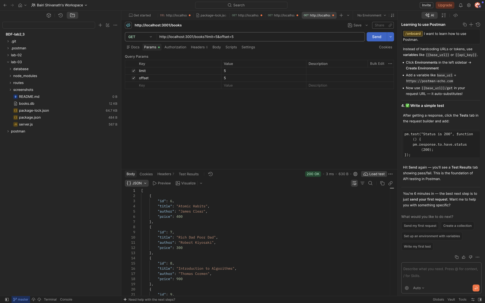

### 7. Price Filtering


### 8. Combined Query Parameters

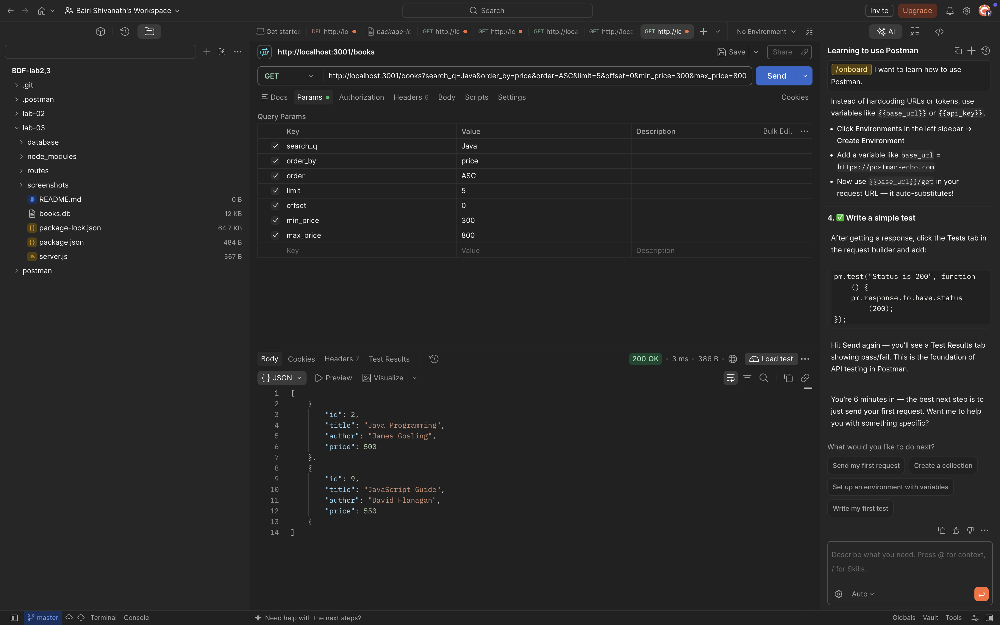

### 9. Add a New Book

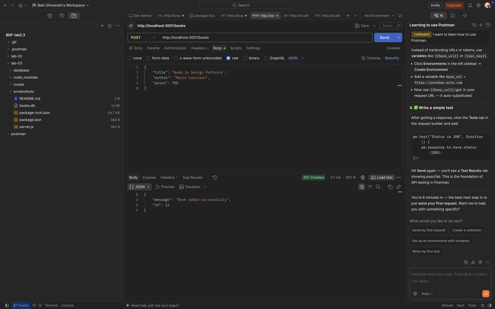

### 10. Validate Missing Title

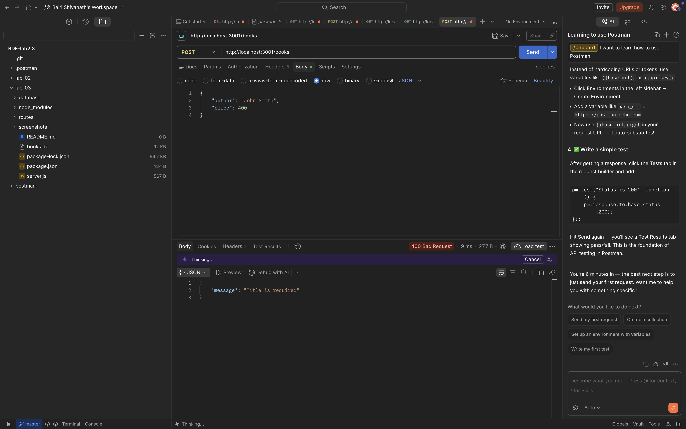

### 11. Validate Missing Author

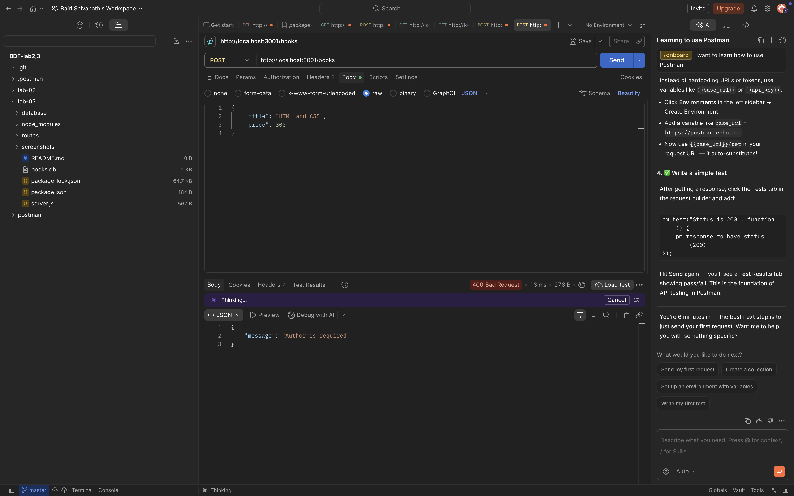

### 12. Validate Invalid Price

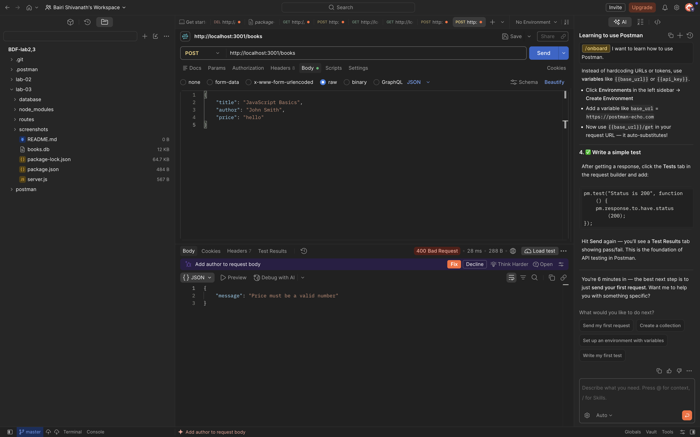

### 13. Update a Book

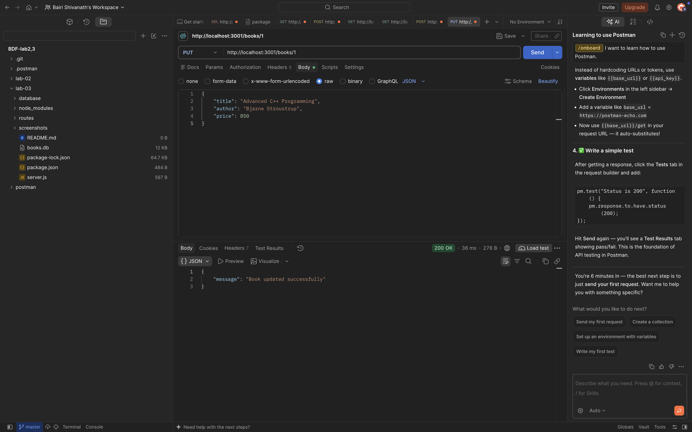

### 14. Delete a Book

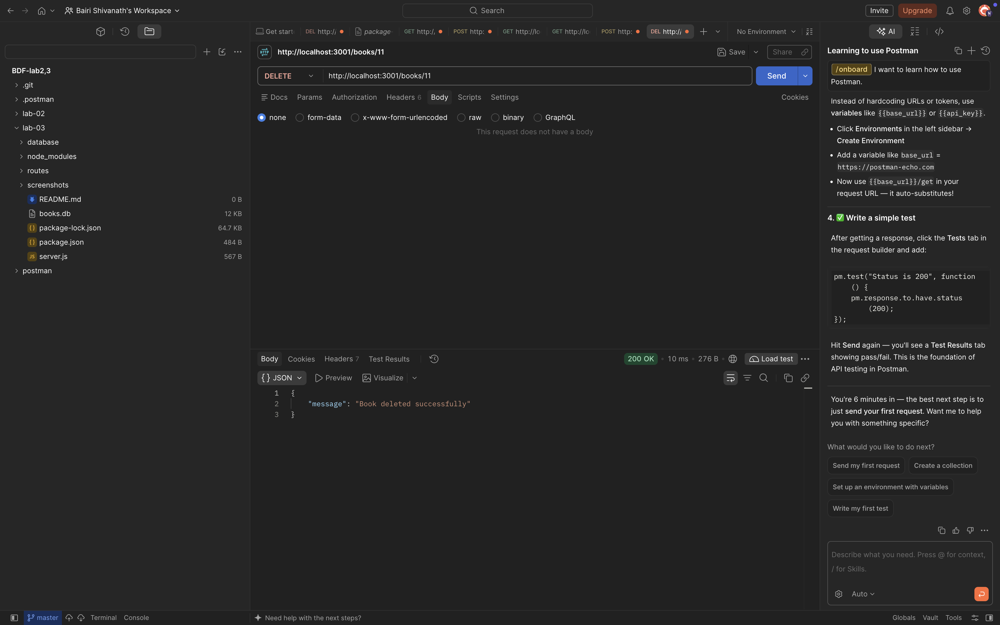

### 15. Handle Book Not Found

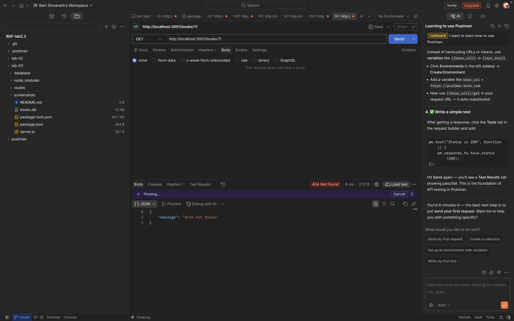

### 16. Invalid Query Parameters

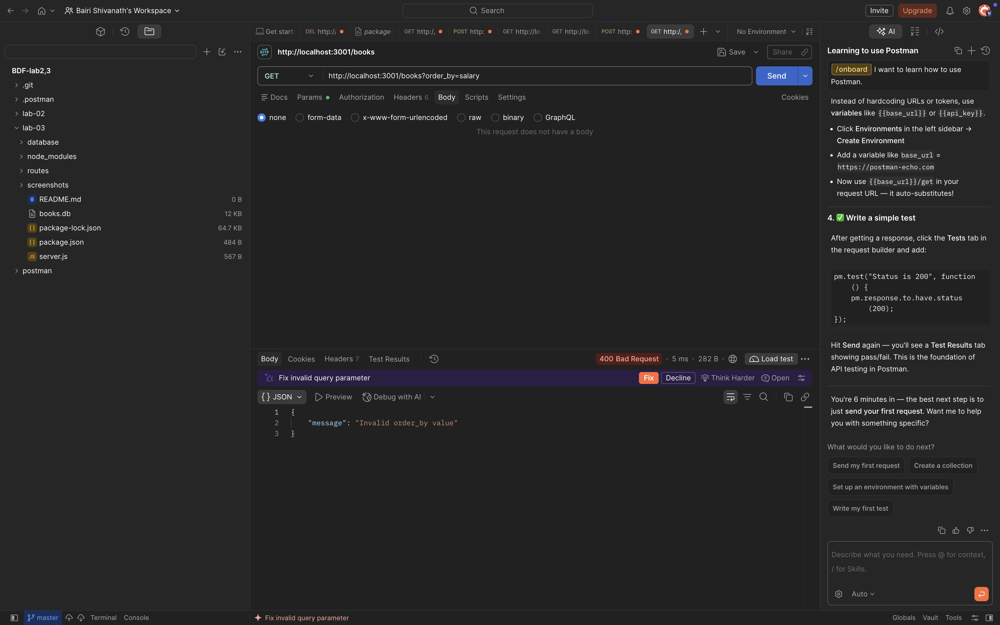

All 16 screenshots are stored in the `screenshots/` directory and document the API testing process.

## GitHub Repository

[View Lab 3 GitHub Repository](https://github.com/nathshiva451-afk/BDF-LAB3)

## Deployment

**Live Deployment URL:** To be added after deployment.

## Learning Outcomes

- Understanding SQLite database operations.
- Implementing RESTful API endpoints.
- Performing CRUD operations.
- Implementing search, sorting, and pagination.
- Applying price filters using SQL queries.
- Validating API request parameters.
- Handling errors and HTTP status codes.
- Testing REST APIs using Postman.
- Managing projects using Git and GitHub.

---

**Subject:** Backend Development Fundamentals

**Lab:** 3 – SQLite Database and Advanced CRUD Operations